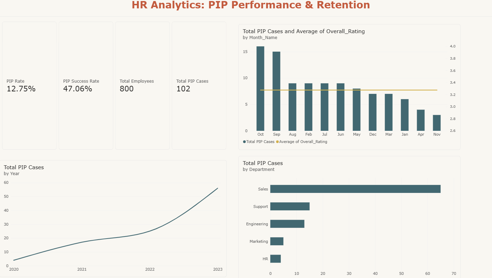
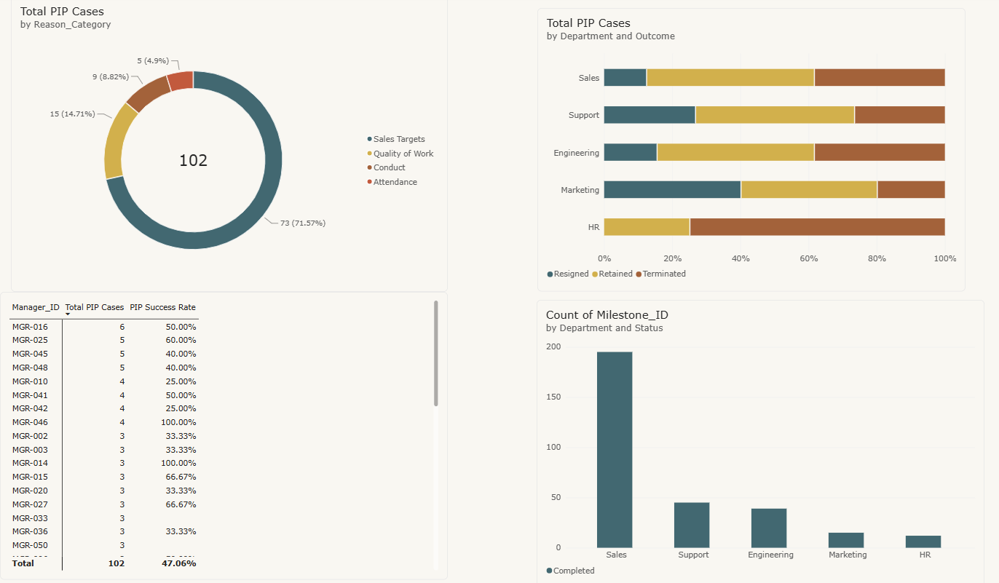

# HR Analytics & PIP Tracker (PowerBI)



## 📌 Executive Summary
**The Business Problem:** HR teams need to know whether Performance Improvement Plans (PIPs) are working. Which departments and regions place the most employees on PIPs? How often do PIPs end in a retained, resigned, or terminated employee? Without a single view, these answers sit in separate spreadsheets and are slow to produce.

**The Solution:** An end-to-end HR analytics dashboard built in Power BI. This dashboard brings reviews, PIP cases, and milestones into one model so HR and managers can monitor performance and retention in a self-service way. 

**Privacy First:** The data model follows a relational star schema and utilizes advanced DAX measures. To ensure complete data privacy, the entire dataset is **fully synthetic**, generated using a custom Python script. No real employee information is used.

---

## 🛠️ Tools & Technologies Used
* **Data Engineering (Synthetic):** Python (Pandas, NumPy, Faker)
* **Data Modeling:** Power BI (Relational Star Schema)
* **Analytics & Visualization:** Power BI Desktop, DAX (Data Analysis Expressions)

---

## 📊 Key Insights & Synthetic Data Patterns
Real HR data is not shared publicly, so the Python generator plants realistic patterns for the dashboard to uncover. These findings demonstrate what the dashboard can surface:

1. **Sales has a higher PIP rate:** The dashboard successfully flags that 25% of Sales employees are placed on a PIP, against 10% elsewhere.
2. **New hires struggle more:** Employees with under a year of tenure at the time of the PIP are far more likely to be terminated or to resign.
3. **Milestones predict outcomes:** The data model reveals that employees who are retained meet most checkpoints, while those who leave miss most of them.
4. **Q4 rating dip:** Performance review ratings consistently trend lower between October and December.



---

## 📂 Project Structure

| File / Folder | Purpose |
| :--- | :--- |
| `HR-Data_Analytics_PIP.pbix` | The Power BI report (data model, DAX measures, and visuals) |
| `data_generator_for_HR.py` | Python script that generates the reproducible synthetic datasets |
| `Sample Employee Data/` | Sample CSV output from the generator, used as the report’s source |

*Note: A screen recording walking through the dashboard functionality will be added to this repository soon.*

---

## ⚙️ Data Engineering & Modeling Approach

### Synthetic Data Generation
`data_generator_for_HR.py` uses `pandas`, `numpy` and `Faker` (with fixed seeds for reproducibility) to create **800 employees** hired between 2020 and 2023. It exports five structured CSV files:
* `employees.csv`: Employee ID, name, department, region, manager ID, hire date, annual salary
* `performance_reviews.csv`: 2 to 4 reviews per employee with overall rating, productivity, and quality scores
* `pip_cases.csv`: PIP start/end dates, reason category, and outcome
* `pip_milestones.csv`: Three checkpoints per PIP with a Met / Not Met status
* `date_dim.csv`: Date dimension (year, quarter, month, day of week)

### The Star Schema
The data model is optimized for BI reporting using a star schema design:
* **Dimension tables:** `employees` and `date_dim`
* **Fact tables:** `performance_reviews`, `pip_cases` and `pip_milestones`

Employees link to reviews and PIP cases through `Employee_ID`, PIP milestones link to PIP cases through `Case_ID`, and dates link through a standard date relationship.

---

## 💻 How to Run This Project

1. **Install the requirements:** 
   ```bash
   pip install pandas numpy faker
